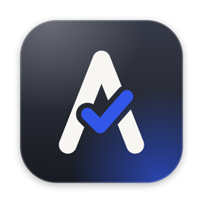

<p align="center">
  
</p>

<h1 align="center">Tolio</h1>

<p align="center">The shortcuts your Mac is missing, in one small menu bar app.<br>
Free, private, and everything stays on your Mac.</p>

<!-- BMC (hidden for now): <p align="center"><a href="https://buymeacoffee.com/keburius">☕ Buy me a coffee</a></p> -->

---

## What it does

Tolio's features come in eight groups.

### Clipboard
| | |
|---|---|
| **Clipboard History** | ⌃⌥V shows what you copied, with picture previews. Pin the ones you need often. |
| **Snippets** | Type a short code such as `;sig` anywhere and it becomes the full text. |

### Windows
| | |
|---|---|
| **Window Layouts** | ⌃⌥←/→/↑/↓ for halves, ⌃⌥D/F/G for thirds, ⌃⌥↩ to maximize. You can also drag windows to screen edges. |
| **Window Switcher** | Hold ⌥ and press Tab to jump to any window, not just any app. |

### Keyboard
| | |
|---|---|
| **Lock Keyboard** | ⌃⌥⌘L locks the keyboard so you can wipe it clean. Unlock it with the mouse. |

### Capture
| | |
|---|---|
| **Screenshots & Recording** | ⇧⌘4 captures an area or a window, then opens an editor with a brush, boxes, numbered steps and text. Untouched captures are copied automatically after 3 seconds. ⌃⌥⌘R records the screen with or without your microphone; you can pause and mute. |
| **Capture Text** | ⇧⌘2 copies the text in any part of the screen, and reads QR codes and barcodes. |

### Files
| | |
|---|---|
| **Drop Ring** | ⌃⌥⌘D, or a shake of the pointer while dragging, opens a ring of circles around the pointer. Drop files on a folder (copy or move), an app (open with), a person (new message or email, sent only when you press Send), a Shortcut, the Cargo shelf (collect files, then drag them all out at once) or the Trash. |

### Island
| | |
|---|---|
| **Notch Island** | The notch becomes a live island. Hover over it (or press ⌃⌥⌘I) to open Now Playing for Music and Spotify, with artwork, progress and controls, or swipe to your calendar. Beside the notch, small "wings" show the music, a recording timer or your next Desk Minder reminder. Notices drop down for charging, low battery, AirPods and volume changes. |

### Energy
| | |
|---|---|
| **Energy Mode** | ⌃⌥⌘A keeps your Mac awake, for a set time or while certain apps run. |

### Extras
| | |
|---|---|
| **Desk Minder** | ⌃⌥⌘E shows a bar above the Dock. Stretch it for more time, or type a time like 18:30, 6pm or 20m, add a title and press Return. When it's due, it fills the screen with Close and Snooze. It can also add the reminder to Apple Reminders, so your iPhone alerts too. |
| **Sticky Notes** | Glass notes on your desktop. Add one with ⌃⌥⌘N or by right-clicking the desktop. |
| **Shortcut cheat sheet** | ⌃⌥⌘/ shows the current app's menu shortcuts. |
| **Text selection actions** | Select text to search the web, open links or translate. |
| **System Stats** | CPU, memory, network and battery in the menu bar. |

Turn each feature on or off in **Settings**. ⌃⌥⌘M opens the control panel from anywhere, and you can change every shortcut in Settings → Shortcuts.

## Install

Requires **macOS 14 (Sonoma) or later**, on Apple silicon or Intel.

1. Download **`Tolio-<version>.dmg`** from the [latest release](../../releases/latest).
2. Open it and drag **Tolio** onto **Applications**.
3. Open Tolio from Applications. The first time, macOS stops it, because Tolio isn't notarized by Apple (that needs a paid developer account; Tolio is a free hobby project). To allow it once:
   - **macOS 15 or later:** click **Done**, then open **System Settings → Privacy & Security**. Scroll down to *"Tolio" was blocked…* and click **Open Anyway**, then confirm with your password.
   - **macOS 14:** right-click (or Control-click) Tolio in Applications, choose **Open**, then click **Open**.

   You only do this once. After that Tolio opens normally.
4. The welcome screen walks you through the rest: choosing features and granting permissions.

<details>
<summary>Prefer Terminal?</summary>

After copying Tolio to Applications, this removes the "downloaded from the internet" flag so macOS doesn't stop it:

```sh
xattr -dr com.apple.quarantine /Applications/Tolio.app
```
</details>

### Check your download (optional)

Each release lists a SHA-256 checksum. Compare it with:

```sh
shasum -a 256 ~/Downloads/Tolio-*.dmg
```

## Permissions

macOS asks you to allow these yourself. Tolio only asks for what the features you turn on need.

| Permission | Used for |
|---|---|
| **Accessibility** | Moving windows, typing snippets, reading selected text and menus, and global shortcuts |
| **Screen Recording** | Screenshots, screen recording, Capture Text and window previews |
| **Microphone** | Only when you record the screen with the microphone turned on |
| **Reminders** | Only if Desk Minder's "Also add to Apple Reminders" is on |
| **Calendars** | Only for Notch Island's calendar page |
| **Automation (Music, Spotify)** | Only for Notch Island's music controls, progress and artwork |
| **Bluetooth** | Only for Notch Island's AirPods and device notices |
| **Finder extension** | "New Sticky Note" in the desktop's right-click menu. Turn on **Tolio** under System Settings → General → Login Items & Extensions → Finder |

## Privacy

- **Tolio never connects to the internet.** No accounts, no analytics, no tracking, no downloads.
- If you turn on Desk Minder's Apple Reminders option, Tolio adds reminders to the Reminders app on your Mac, and Apple's iCloud syncs them to your other devices. Tolio itself sends nothing.
- Clipboard contents, notes and text you select or capture are never written to logs.
- Files Tolio deletes, such as recordings you discard and old clipboard images, go to the **Trash** and are never erased outright.

## Uninstall

1. Click Tolio's menu bar icon, then **Quit Tolio**.
2. Move **Tolio** from Applications to the Trash.
3. Optional: to remove your data too, move these to the Trash:
   - `~/Library/Application Support/com.george.tolio`
   - `~/Library/Preferences/com.george.tolio.plist`
   - `~/Library/Containers/com.george.tolio.FinderNote`
   - `~/Library/Caches/com.george.tolio`
4. Optional: remove Tolio from the lists in System Settings → Privacy & Security.

## Build from source

You need Xcode 26 or later and [XcodeGen](https://github.com/yonaskolb/XcodeGen) (`brew install xcodegen`).

```sh
make test   # build and run all tests
make run    # build and start the Debug app
make dmg    # universal Release build → dist/Tolio-<version>.dmg (+ .sha256)
```

A fresh clone builds ad-hoc signed. To keep permissions across rebuilds, add your own signing identity in `Config/Signing.local.xcconfig` (see `Config/Base.xcconfig`).

Tolio is written in Swift 6 with SwiftUI and AppKit. Each feature is its own module in `OmniKit/` (the project's original code name).

## Credits

- [GRDB.swift](https://github.com/groue/GRDB.swift) by Gwendal Roué (MIT License), vendored in `Vendor/GRDB`.

<!-- BMC (hidden for now):
## Support

Tolio is free. If it saves you time, you can [buy me a coffee ☕](https://buymeacoffee.com/keburius).
-->

## License

[MIT](LICENSE) © 2026 keburius
